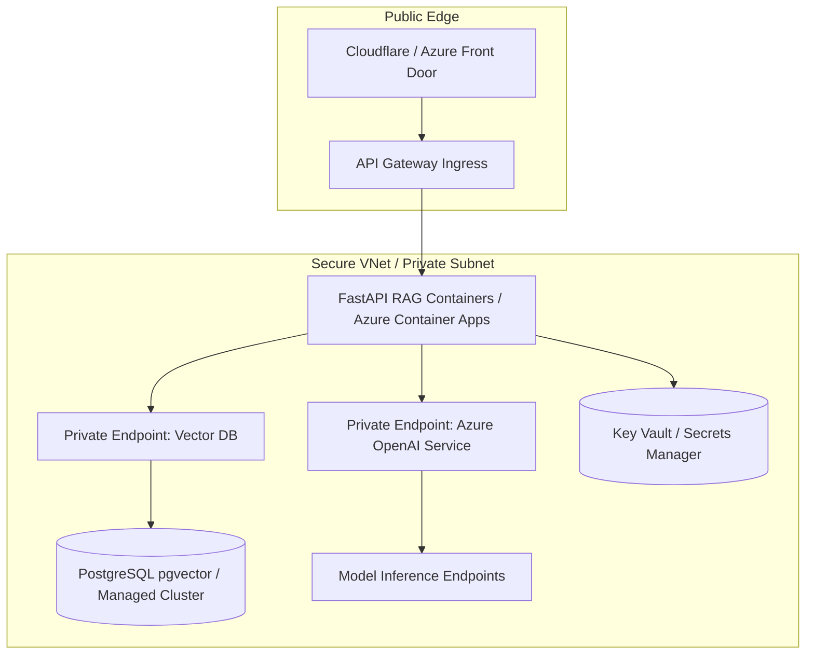

# Enterprise Cloud Infrastructure for Generative AI (Terraform)

Blueprint de **Infraestructura como Codigo (IaC)** en Terraform disenado para el despliegue desacoplado, seguro y altamente disponible de servicios de **IA Generativa y RAG** en entornos corporativos (Microsoft Azure / AWS).

## Arquitectura de Red y Aislamiento

El diseno implementa un modelo **Zero Trust** estricto: ninguna API de LLM ni base de datos vectorial expone interfaces publicas a Internet. Toda la comunicacion intra-servicio ocurre mediante redes privadas virtuales (VNet/VPC) y puntos de enlace privados (Private Endpoints).



## Pilares de Diseno de Infraestructura
- **Aislamiento de Red:** Subredes dedicadas para computo (Container Apps/ECS) y datos (pgvector/OpenAI) sin IPs publicas.
- **Identidades Administradas:** Eliminacion de tokens y credenciales estaticas usando Managed Identities (Azure) / IAM Roles (AWS).
- **Seguridad perimetral y Cifrado:** Cifrado en reposo y en transito (TLS 1.3), con gestion centralizada de secretos via Key Vault / Secrets Manager.
- **Escalabilidad Horizontal:** Auto-escalado de contenedores basado en concurrencia HTTP y metricas de cola de inferencia.

## Estructura del Modulo

```text
├── environments/
│   ├── dev/
│   └── prod/
├── modules/
│   ├── network/        # VNets, Subnets, NSGs, Private Endpoints
│   ├── compute/        # Azure Container Apps / ECR + ECS
│   ├── database/       # Flexible Server PostgreSQL con soporte pgvector
│   └── ai_services/    # Azure OpenAI deployments (GPT-4o, Embeddings)
├── main.tf
├── variables.tf
├── outputs.tf
└── terraform.tfvars.example
```

## Despliegue

```bash
# 1. Inicializar providers y modulos
terraform init

# 2. Validacion estatica y planificacion de ejecucion
terraform plan -out=tfplan

# 3. Aplicar infraestructura
terraform apply tfplan
```